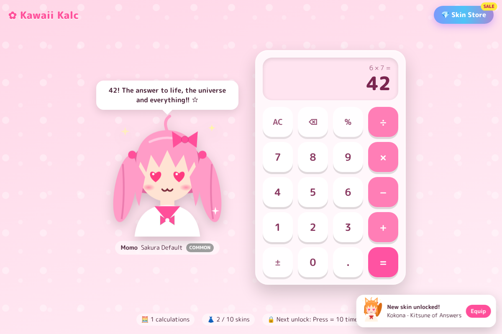
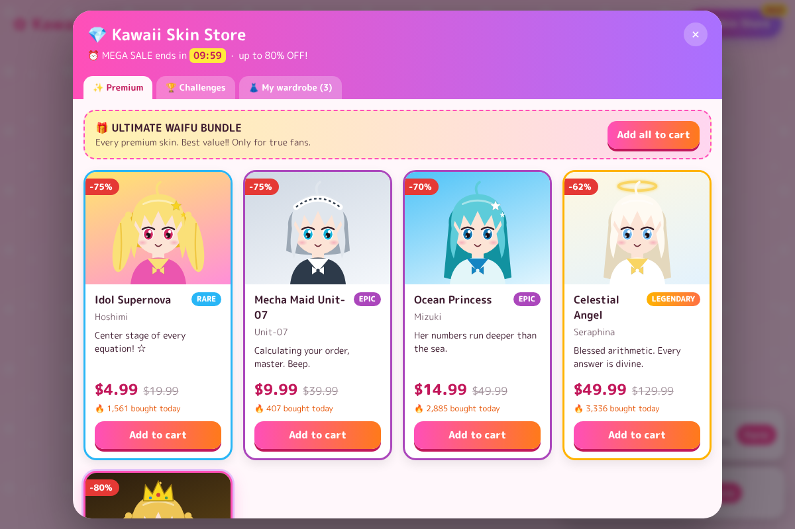
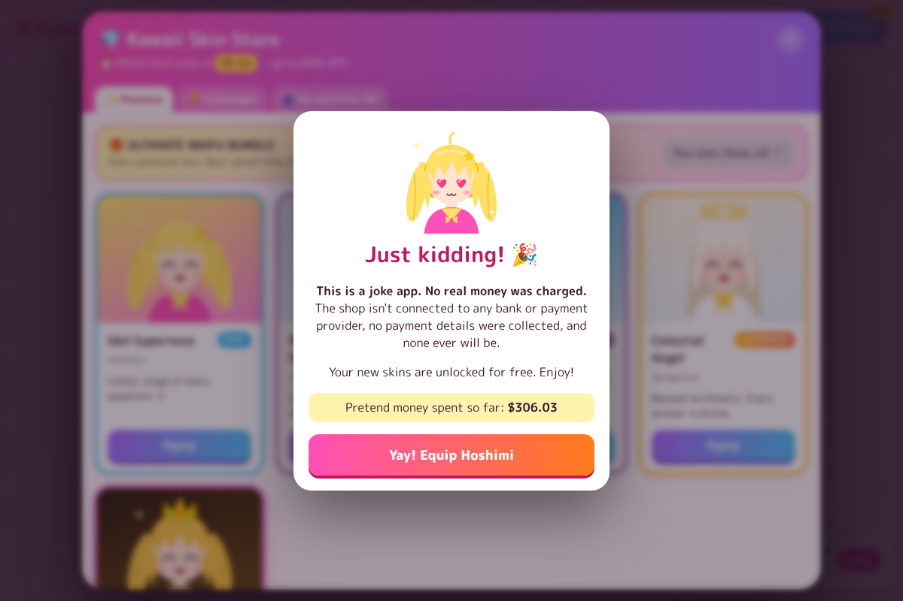

# ✿ Kawaii Kalc

A fully working calculator with an anime girl mascot, unlockable skins and a
**completely fake** "real money" skin store. Built with Blazor WebAssembly on .NET 10.



## Run it

```bash
cd AnimeCalculator
dotnet run --project src/AnimeCalculator
```

Then open the URL it prints. Run the tests with `dotnet test`.

## What's in the box

- **Calculator**: + − × ÷, %, ±, backspace, repeat-equals, decimal maths (so `0.1 + 0.2 = 0.3`),
  and keyboard support (digits, `+ - * /`, `Enter`, `Backspace`, `Esc`).
- **Mascot**: an original chibi character drawn in SVG who reacts to what you do.
  She cheers at results, panics when you divide by zero, and has opinions about 42 and 69.
- **Skins**: 10 original characters. Each one recolours both the mascot and the calculator.

| How you get it | Skins |
| --- | --- |
| Free | Momo (Sakura Default) |
| Challenges | Kuro (10 calculations), Kokona (get 42), Err0r / Glitch-chan (divide by zero), Shizu (50 calculations) |
| "Premium" store | Hoshimi $4.99, Unit-07 $9.99, Mizuki $14.99, Seraphina $49.99, Reika $199.99 |

Progress is saved in your browser's localStorage.

## The skin store is a joke



The store looks like a real-money shop on purpose: sale prices, a countdown that never ends,
"🔥 1,561 bought today", a bundle, a cart and a checkout with fees like the *Kawaii processing fee*.

**None of it is real.** There is no payment integration, no card fields, no network calls and
nothing is ever charged. Pressing **Pay** shows a "Just kidding!" screen that explains this and
unlocks the skins for free. The app keeps a running total of your *pretend* money spent.



## Layout

```
src/AnimeCalculator.Core   Pure C#: calculator engine, skin catalog, unlock rules, player profile, checkout quote
src/AnimeCalculator        Blazor WebAssembly UI (Home page, Mascot, SkinShop, CheckoutDialog)
tests/AnimeCalculator.Tests xUnit tests for the Core library
```

All characters and artwork are original and made for this project.
